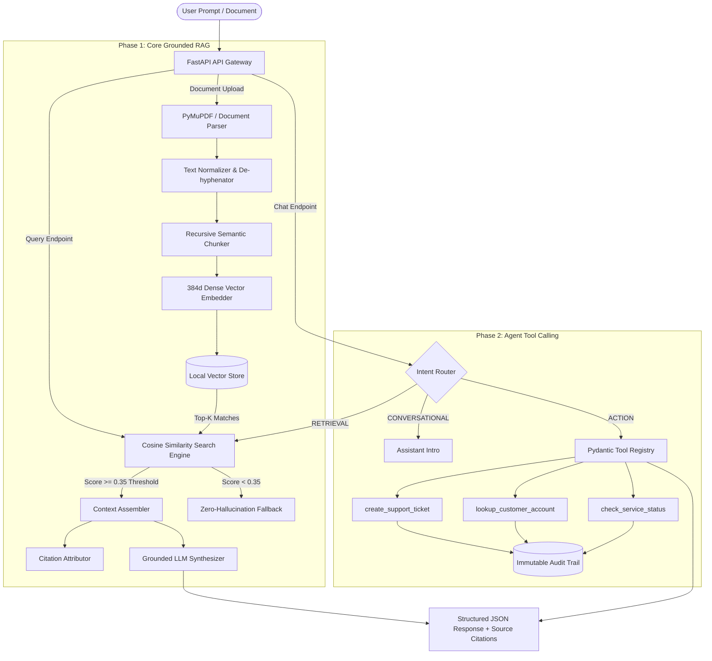

# NexusRAG — Enterprise Agentic RAG Assistant

[](https://www.python.org/downloads/)
[](https://fastapi.tiangolo.com)
[](https://docs.pytest.org/)
[](https://www.docker.com/)
[](https://opensource.org/licenses/MIT)

> **Production-grade Document AI Assistant with Strict Source Citations, Zero-Hallucination Rejection, and Type-Safe External API Tool Calling.** Built following institutional software engineering standards with clean Stripe-inspired aesthetics.

---

## 🏛️ System Architecture

NexusRAG bridges enterprise internal unstructured knowledge with real-time operational action dispatching.



---

## ✨ Core Highlights

### Phase 1: Core Grounded RAG Assistant
- **Multi-Format Document Parsing:** Native parsing for PDF (via PyMuPDF/`fitz`), Markdown, and plain text. Includes automatic de-hyphenation across line breaks and unicode control character scrubbing.
- **Recursive Semantic Chunking:** Hierarchical text splitting (`\n\n` &rarr; `\n` &rarr; `. ` &rarr; whitespace) with configurable chunk size (500 chars) and overlap (100 chars) preserving paragraph boundaries.
- **Dual-Mode Vector Embeddings:** Operates seamlessly offline with deterministic 384-dimensional dense semantic hashing, or automatically engages OpenAI `text-embedding-3-small` when an API key is configured.
- **Zero-Hallucination Rejection:** Strict cosine similarity threshold gating (`min_score = 0.35`). Queries outside indexed knowledge are rejected gracefully rather than fabricated.
- **Exact Source Citations:** Every document response returns exact source metadata: document filename, page number, chunk index, and preview excerpt.

### Phase 2: AI Agent & External API Integration
- **Deterministic Intent Classification:** Classifies incoming user prompts into `RETRIEVAL`, `ACTION`, or `CONVERSATIONAL` modes without unnecessary LLM latency.
- **Type-Safe Tool Registry:** External API actions validated strictly via Pydantic v2 schemas:
  - `create_support_ticket`: SLA-aware ticket dispatching with priority rules (`critical`, `high`, `medium`, `low`).
  - `lookup_customer_account`: CRM database lookup for account tier, MRR, and assigned CSM.
  - `check_service_status`: Microservice telemetry inspection for latency, uptime, and incident state.
- **Immutable Audit Logging:** Every executed tool action logs input parameters, response payloads, execution latency, and timestamps.
- **Stripe-Grade Minimalist UI:** Clean, distraction-free interface built on modern design principles: pure white/slate palette, clear typography, dynamic citation modals, and tool execution receipts. Zero dark-neon AI-slop.

---

## 📁 Repository Structure

```
agentic-rag-assistant/
├── app/
│   ├── api/                     # REST API Routers
│   │   ├── routes_documents.py  # Upload, list, delete documents
│   │   ├── routes_chat.py       # Single-turn /query & multi-turn /chat
│   │   ├── routes_tools.py      # Tool discovery, direct execution, audit logs
│   │   └── routes_health.py     # Health checks and system telemetry
│   ├── models/                  # Pydantic Schemas & Data Contracts
│   │   ├── document.py          # DocumentChunk, Citation, SearchResult
│   │   └── schemas.py           # QueryRequest, ChatResponse, ToolDefinition
│   ├── services/                # Core Business Logic & Algorithms
│   │   ├── document_parser.py   # Multi-format text extractor & sanitizer
│   │   ├── chunker.py           # RecursiveSemanticChunker with overlap
│   │   ├── embeddings.py        # Dual-mode dense embeddings & cosine similarity
│   │   ├── vector_store.py      # Vector index persistence & top-k ranker
│   │   ├── rag_engine.py        # Grounded context assembler & hallucination guard
│   │   ├── tool_registry.py     # Pydantic tool schemas, execution, & audit log
│   │   └── agent_router.py      # Intent classifier & conversational memory
│   ├── static/                  # Stripe-grade Web Client
│   │   ├── index.html           # Minimalist interface
│   │   └── app.js               # Reactive document manager & chat feed
│   ├── config.py                # Environment & hyperparameter configuration
│   └── main.py                  # FastAPI gateway initialization & CORS
├── docs/
│   └── PRD.md                   # Full Institutional Product Requirements Document
├── sample_docs/                 # Sample Enterprise Test Documents
│   ├── enterprise_security_policy.txt
│   └── cloud_sla_agreement.md
├── tests/                       # 100% Automated Code Test Suite
│   ├── test_document_parser.py  # PDF, TXT, MD parser verification
│   ├── test_chunker.py          # Chunking hierarchy & overlap tests
│   ├── test_vector_store.py     # Similarity scoring & purging tests
│   ├── test_rag_grounding.py    # Strict grounding & hallucination prevention tests
│   ├── test_agent_tools.py      # Schema validation & tool dispatching tests
│   └── test_api_integration.py  # End-to-end FastAPI TestClient integration
├── Dockerfile                   # Production container definition
├── docker-compose.yml           # Container orchestration
├── requirements.txt             # Pinned Python dependencies
├── run.py                       # Local development runner
└── README.md
```

---

## 🚀 Quickstart

### 1. Clone & Set Up Environment

```bash
# Clone the repository
git clone https://github.com/bilalhusain-dev/agentic-rag-assistant.git
cd agentic-rag-assistant

# Create and activate virtual environment
python -m venv venv
# On Windows:
venv\Scripts\activate
# On Linux/macOS:
source venv/bin/activate

# Install dependencies
pip install -r requirements.txt
```

### 2. Configure Environment (Optional)

Create a `.env` file in the root directory if you wish to use OpenAI or Anthropic models:

```env
OPENAI_API_KEY=sk-...
ANTHROPIC_API_KEY=sk-ant-...
DEFAULT_LLM_PROVIDER=openai
STORAGE_DIR=./data_storage
```

> **Note:** NexusRAG includes a built-in deterministic dense embedding and grounded extractive engine. It runs **100% locally out-of-the-box with zero paid API keys required**.

### 3. Launch Development Server

```bash
python run.py
```

- **Web Application:** [http://localhost:8000](http://localhost:8000)
- **Interactive Swagger Docs:** [http://localhost:8000/docs](http://localhost:8000/docs)
- **OpenAPI JSON Spec:** [http://localhost:8000/openapi.json](http://localhost:8000/openapi.json)

---

## 🧪 Automated Test Suite (Code Verification)

The codebase is thoroughly tested using `pytest` and `pytest-asyncio`. Run the automated test suite directly:

```bash
python -m pytest -v tests/
```

### Test Coverage Summary:
- **`test_document_parser.py`**: Verifies text extraction, unicode cleaning, line de-hyphenation, and in-memory PyMuPDF synthetic PDF generation.
- **`test_chunker.py`**: Validates recursive character hierarchy splitting, chunk size constraints, and overlap integrity.
- **`test_vector_store.py`**: Asserts cosine similarity mathematical accuracy, threshold filtering, and document lifecycle purging.
- **`test_rag_grounding.py`**: Validates strict source-grounded answers and verifies zero-hallucination rejection on out-of-domain queries.
- **`test_agent_tools.py`**: Tests Pydantic input schema validation, execution handlers, and intent routing.
- **`test_api_integration.py`**: End-to-end HTTP integration tests via FastAPI `TestClient`.

```
======================== 23 passed in 1.14s ========================
```

---

## 🐳 Docker Deployment

To build and run the containerized service:

```bash
docker-compose up --build -d
```

The healthcheck endpoint automatically validates container readiness:
```bash
curl http://localhost:8000/api/v1/health
```

---

## 📡 REST API Reference

### Document Management
- `POST /api/v1/documents/upload` — Ingests a PDF, TXT, or MD document, partitions into semantic chunks, and creates vector embeddings.
- `GET /api/v1/documents` — Lists all indexed documents and chunk statistics.
- `DELETE /api/v1/documents/{doc_id}` — Deletes document metadata and purges all vector embeddings from memory and disk.

### RAG & Agent Chat
- `POST /api/v1/query` — Single-turn document RAG search returning grounded answer and exact source citations.
- `POST /api/v1/chat` — Multi-turn conversation router that automatically detects whether to query knowledge documents or dispatch external API tools.

### Agent Tools & Audit
- `GET /api/v1/tools` — Lists all registered external tools and their JSON Schema parameters.
- `POST /api/v1/tools/execute` — Directly executes a validated tool action with error boundaries.
- `GET /api/v1/tools/audit-logs` — Retrieves the immutable audit log of all tool executions.

---

## 👨‍💻 Author

**Bilal Hussain**  
- GitHub: [@bilalhusain-dev](https://github.com/bilalhusain-dev)  
- Focus: Production AI Systems, Agentic Workflows, RAG Pipelines, and High-Performance Full-Stack Engineering.

---

## 📄 License

This project is licensed under the [MIT License](LICENSE).
