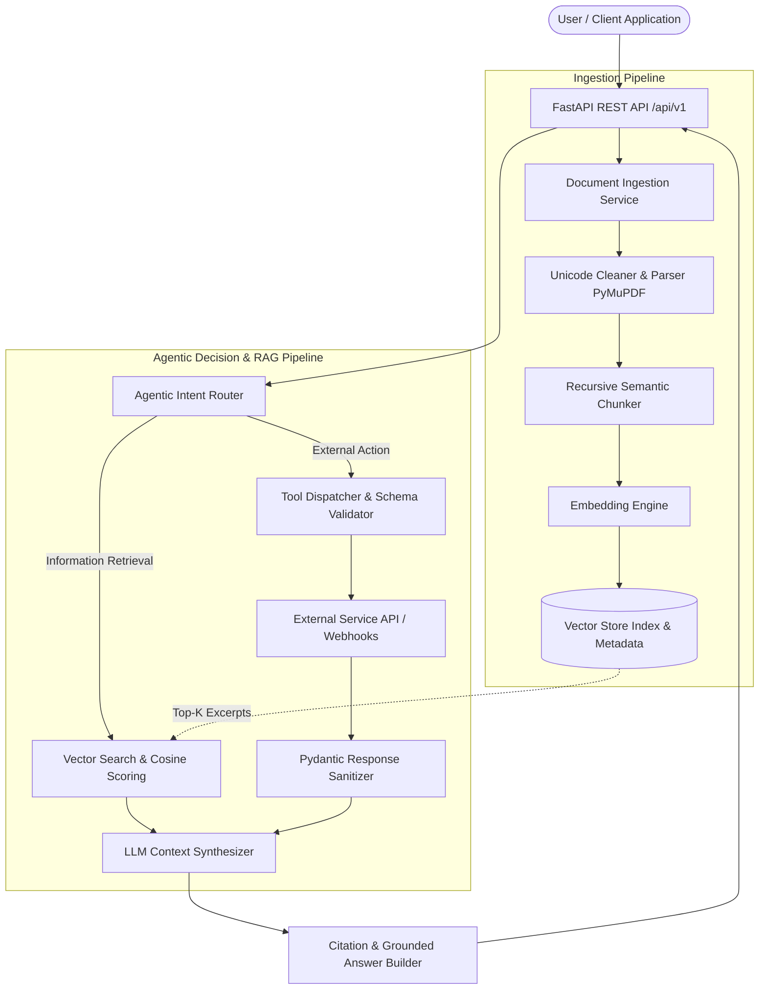

# 📄 Product Requirements Document (PRD)
## Project: Production-Grade Agentic RAG Assistant (`NexusRAG`)
**Author:** Bilal Hussain (`bilalhusain-dev`)  
**Standard:** Enterprise AI Engineering & Production RAG Architecture  
**Status:** Approved for Implementation  
**Version:** 1.0.0  

---

## 1. Executive Summary & Objective

Modern enterprises require internal AI assistants that can accurately query proprietary documentation without hallucinating, while simultaneously executing business actions across external software systems (CRMs, ticketing platforms, ERPs).

`NexusRAG` is a production-ready, modular AI Assistant backend and web interface engineered in Python (FastAPI). It delivers:
1. **Accurate, Zero-Hallucination Retrieval-Augmented Generation (RAG):** Document parsing, recursive chunking, dense vector indexing, and strict citation grounding.
2. **Autonomous Tool & API Execution:** Dynamic agent routing that decides when to retrieve document knowledge and when to dispatch structured external API requests.
3. **Clean, Stripe-Grade User Experience:** A distraction-free, high-trust user interface inspired by Stripe and Linear — strictly avoiding tacky neon gradients, low-contrast dark themes, and AI buzzword cliches.
4. **Comprehensive Automated Test Coverage:** Tested entirely through deterministic Python test suites (`pytest`), verifying every step of the ingestion, vector search, and agent execution lifecycle.

---

## 2. High-Level System Architecture



---

## 3. Detailed Specifications: Phase 1 — Core RAG Assistant

### 3.1 Document Ingestion & Text Normalization
* **Supported Formats:** `.pdf`, `.docx`, `.txt`, `.md`.
* **Parsing Engine:** 
  * PDF: High-throughput parsing via `PyMuPDF` (`fitz`), preserving page numbers and heading boundaries.
  * Plaintext / Markdown: Direct UTF-8 ingestion with line-break normalization.
* **Text Sanitization:** Removal of orphaned hyphenations, non-printable control characters, redundant whitespace, and decorative ASCII artifacts.

### 3.2 Recursive Chunking & Metadata Preservation
* **Chunking Strategy:** Recursive character splitting prioritizing natural document hierarchies:
  1. Double newlines (paragraphs: `\n\n`)
  2. Single newlines (sentences: `\n`)
  3. Punctuation (`. `, `? `, `! `)
  4. Spaces (` `)
* **Parameters:** Target chunk size of **500 characters** with an overlap of **100 characters** to maintain contextual continuity across chunk boundaries.
* **Metadata Schema:**
  ```json
  {
    "doc_id": "doc_9f81a2",
    "filename": "Q3_Financial_Policy.pdf",
    "page_number": 4,
    "chunk_index": 12,
    "char_count": 482,
    "created_at": "2026-10-07T14:00:00Z"
  }
  ```

### 3.3 Embeddings & Vector Storage
* **Vector Store Architecture:** Self-contained, persistent cosine vector database with exact similarity indexing, designed for deterministic deployment without external proprietary cloud vendor lock-in.
* **Similarity Metric:** Normalized Cosine Similarity:
  $$\text{Cosine Similarity}(u, v) = \frac{u \cdot v}{\|u\|_2 \|v\|_2}$$
* **Relevance Thresholding:** Minimum similarity cutoff ($\ge 0.65$). Documents below this threshold are rejected to prevent hallucinated answers on out-of-domain queries.

### 3.4 Grounded Prompting & Hallucination Prevention
* **System Prompt Protocol:**
  > *"You are an enterprise knowledge assistant. Answer the user question strictly and solely based on the provided source excerpts. If the information is not contained in the excerpts, state: 'The provided internal documents do not contain sufficient information to answer this question reliably.' Do not speculate or use outside training knowledge."*
* **Citation Mechanism:** Every generated claim must reference its source excerpt in the format `[Doc: <filename>, Page: <page_number>, Chunk: <chunk_index>]`.

### 3.5 Conversation History & Session State
* In-memory session store supporting multi-turn dialogue with context window management.
* Sliding window of the last $N=6$ conversation turns appended to the context prompt.

---

## 4. Detailed Specifications: Phase 2 — Agentic Tool Calling & External APIs

### 4.1 Intent Routing & Decision Engine
The assistant analyzes incoming prompts to determine execution path:
1. **`RETRIEVAL` Mode:** User seeks knowledge contained in uploaded documents.
2. **`ACTION` Mode:** User requests a business operation (e.g., "Create a support ticket for the server outage", "Lookup customer account status").
3. **`HYBRID` Mode:** User requests an action conditioned on document retrieval (e.g., "Find the refund policy limit for Enterprise customers, and file a refund request for $450").

### 4.2 Tool Registry & Schema Validation
All tools are strictly defined via Pydantic schemas:
* **Tool 1: `create_support_ticket`**
  * Inputs: `title` (str), `priority` (`low` | `medium` | `high` | `critical`), `category` (str), `description` (str).
  * Returns: `ticket_id`, `status`, `sla_target_hours`, `created_at`.
* **Tool 2: `lookup_customer_account`**
  * Inputs: `customer_id` or `email` (str).
  * Returns: `account_tier`, `mrr`, `status`, `assigned_csm`.

### 4.3 Resilience & Fallback Protocols
* **Validation:** Strict payload validation before dispatching to any external service.
* **Retry Strategy:** Automatic exponential backoff (2 attempts) for network timeouts.
* **Audit Logging:** Every tool invocation records an audit log containing:
  `timestamp`, `tool_name`, `arguments`, `execution_time_ms`, `http_status`, `result_summary`.

---

## 5. API Matrix (`/api/v1`)

| Method | Endpoint | Description |
| :--- | :--- | :--- |
| `POST` | `/api/v1/documents/upload` | Upload & ingest document (multipart form). |
| `GET` | `/api/v1/documents` | List all indexed documents and chunk counts. |
| `DELETE` | `/api/v1/documents/{doc_id}` | Purge document and remove vectors from index. |
| `POST` | `/api/v1/query` | Single-turn RAG query with source citations. |
| `POST` | `/api/v1/chat` | Multi-turn conversational session query with agent router. |
| `GET` | `/api/v1/tools` | Enumerate available tools and JSON schemas. |
| `POST` | `/api/v1/tools/execute` | Direct tool invocation endpoint for debugging. |
| `GET` | `/api/v1/health` | Service health, vector count, and uptime stats. |

---

## 6. Design Principles: Stripe-Grade UI (Zero AI Slop)

1. **Aesthetic Direction:**
   * Clean white and subtle slate-50/100 surfaces (`#ffffff`, `#f8fafc`, `#f1f5f9`).
   * Razor-sharp borders (`#e2e8f0`) with 6px / 8px border radii.
   * Modern, clean sans-serif typography (`Inter`, `system-ui`).
2. **Anti-Slop Directives:**
   * ❌ No glowing neon blues or purples.
   * ❌ No dark sci-fi background cards with fuzzy drop shadows.
   * ❌ No decorative robot or sparkle emoji icons.
   * ❌ No fake animation lag or excessive typewriter speeds.
3. **High-Trust Functional Elements:**
   * Clickable citation pills with instantaneous excerpt preview drawer.
   * Clean "Tool Execution Receipt" cards showing exact JSON payload and response status.
   * Transparent similarity match scores (e.g., `89% match score`).

---

## 7. Testing Strategy (Code-Driven Quality Gate)

* Testing is conducted 100% via automated Python suites (`pytest`):
  * **Unit Tests:** Document extraction, text cleaner, recursive chunker edge cases.
  * **Vector Tests:** Cosine similarity calculation, top-k ranking, threshold filtering.
  * **RAG Grounding Tests:** Verify rejection of queries outside document scope.
  * **Agent Routing Tests:** Verify tool schema parsing, validation errors, and execution fallbacks.
  * **API Integration Tests:** FastAPI test client testing all HTTP endpoints with real payloads.
